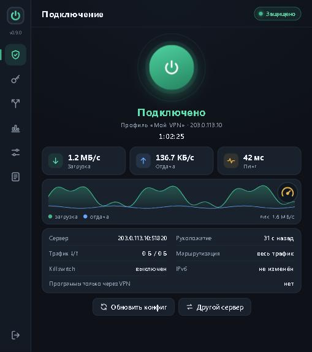
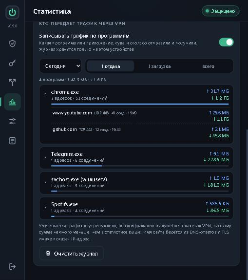
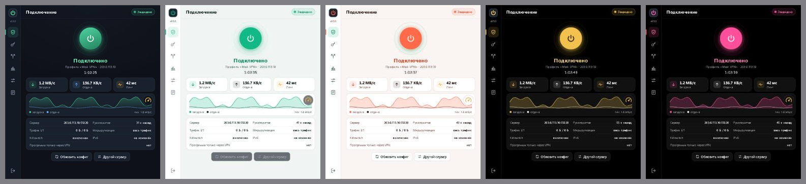

# AWG Pilot

**An AmneziaWG VPN client for Windows and Android** that keeps the connection alive by itself, shows where your traffic goes, and stays out of the way.

[Русская версия](README.ru.md) · [Download](../../releases/latest)

## Features

**Connection**
- AmneziaWG 3.1 engine (compatible with AmneziaWG 2.0 servers).
- Works with keys starting with `vpn://` (so far tested with Sotka VPN keys) and with AmneziaVPN keys (`.vpn` files), plus AmneziaWG `.conf` files; several profiles side by side.
- Self-healing link: the server is pinged every 5 seconds. When pings stop, AWG Pilot reconnects, reconnects again, fetches a fresh config, moves to the next profile, asks the provider for another server, and repeats the round until the link works. A Wi-Fi ↔ mobile switch is checked within seconds.

**Protection**
- Kill switch and "no internet while the VPN is down" lockdown (Windows Filtering Platform).
- "Only through the VPN" for chosen programs (Windows) and per-app split tunnelling (Android).
- IPv6 leak protection, custom DNS (Cloudflare, Quad9, AdGuard or your own), Russian networks bypassing the VPN.

**Insight**
- Built-in speed test that measures the tunnel, not your Wi-Fi.
- Daily usage statistics and a traffic log by program and destination (host names from DNS and TLS) for a day, a week, a month, 6 or 12 months or all time.
- A transparent DU Meter style status window on the desktop (Windows).

**Look**
- 11 colour themes: the default dark one plus 10 flat two-colour skins.

## Install

Download the files from [Releases](../../releases/latest).

**Windows 10/11 (x64):** run `AWGPilot-<version>-Windows-x64-setup.exe`. Administrator rights are needed once: the installer registers the "AWG Pilot VPN" service that holds the tunnel, so the window itself runs without them. The installer is not code-signed yet, so SmartScreen will warn: choose "More info" → "Run anyway".

**Android 5.0+:** install `AWGPilot-<version>-Android.apk` and allow installs from that source. One APK covers arm64, armv7 and x86_64.

## First steps

1. Turn off any other VPN client that uses the same key: two clients with one key revoke each other's configs.
2. Open AWG Pilot → **Keys and profiles** → paste a key or import a `.vpn` / `.conf` file.
3. Press the power button. The status window and the traffic log are in **Settings** and **Statistics**.

The interface is in Russian.

## How it works

The same Go core runs on both platforms. On Windows a LocalSystem service owns the WinTun adapter, routes, DNS and firewall rules, and the Wails window talks to it over a named pipe. On Android the core is a JNI library behind `VpnService` with a WebView interface. Keys and configs are stored encrypted (DPAPI on Windows, Android Keystore on Android). See [docs/DEVELOPMENT.ru.md](docs/DEVELOPMENT.ru.md) for the internals and build steps.

## Build from source

- **Windows:** Go 1.26, Node.js, [Wails v2](https://wails.io): `wails build -platform windows/amd64 -trimpath -ldflags "-s -w"`, add `-nsis` (NSIS 3) for the installer.
- **Android:** Android SDK (build-tools 36.1, platform 36), NDK 28, JDK 17+: `android\build.ps1`, no Gradle needed.

## Credits

Built on [amneziawg-go](https://github.com/amnezia-vpn/amneziawg-go), [amneziawg-windows](https://github.com/amnezia-vpn/amneziawg-windows), [WinTun](https://www.wintun.net), [Wails](https://wails.io) and [gVisor](https://gvisor.dev). See [THIRD_PARTY_NOTICES.md](THIRD_PARTY_NOTICES.md).

AWG Pilot is an independent project and is not affiliated with Amnezia, WireGuard or any VPN provider. WireGuard is a registered trademark of Jason A. Donenfeld.

## License

Not chosen yet: all rights reserved until the project is published.
