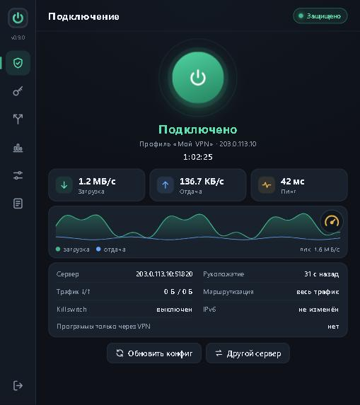
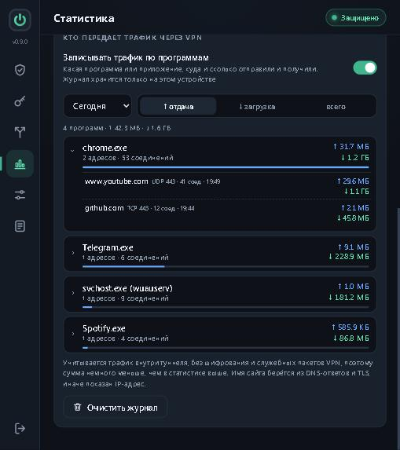
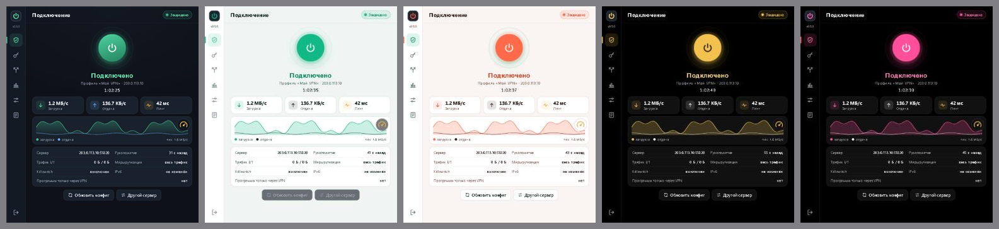

# AWG Pilot

**VPN-клиент AmneziaWG для Windows и Android**, который сам держит соединение, показывает, куда уходит трафик, и не мешает работать.

[English version](README.md) · [Скачать](../../releases/latest)

## Возможности

**Подключение**
- Движок AmneziaWG 3.1 (работает и с серверами AmneziaWG 2.0).
- Совместим с ключами, начинающимися на `vpn://` (пока проверено только с ключами Sotka VPN), и с ключами AmneziaVPN (файлы `.vpn`), а также с конфигами AmneziaWG `.conf`; несколько профилей.
- Автовосстановление: сервер пингуется каждые 5 секунд. Если пинг пропал, AWG Pilot переподключается, пробует ещё раз, берёт свежий конфиг, переходит на следующий профиль, просит у провайдера другой сервер и повторяет круг, пока связь не появится. Переход Wi-Fi ↔ мобильная сеть проверяется за секунды.

**Защита**
- Kill switch и отключение интернета при обрыве VPN (фильтры Windows Filtering Platform).
- «Только через VPN» для выбранных программ (Windows) и выбор приложений для туннеля (Android).
- Защита от утечки IPv6, свой DNS (Cloudflare, Quad9, AdGuard или свои адреса), российские сети мимо VPN.

**Контроль**
- Тест скорости, который меряет именно туннель, а не Wi-Fi.
- Статистика трафика по дням и журнал по программам и адресам (имена сайтов из DNS и TLS) за день, неделю, месяц, 6 и 12 месяцев или всё время.
- Прозрачное окошко статуса на рабочем столе в стиле DU Meter (Windows).

**Оформление**
- 11 тем: тёмная по умолчанию и 10 плоских двухцветных.

## Установка

Файлы лежат в [Releases](../../releases/latest).

**Windows 10/11 (x64):** запустите `AWGPilot-<версия>-Windows-x64-setup.exe`. Права администратора нужны один раз: установщик регистрирует службу «AWG Pilot VPN», которая держит туннель, а само окно работает без них. Подписи кода пока нет, поэтому SmartScreen предупредит: «Подробнее» → «Выполнить в любом случае».

**Android 5.0+:** установите `AWGPilot-<версия>-Android.apk` и разрешите установку из этого источника. Один APK подходит для arm64, armv7 и x86_64.

## Первые шаги

1. Выключите другие VPN-клиенты с тем же ключом: два клиента с одним ключом отзывают конфиги друг у друга.
2. Откройте AWG Pilot → **Профили и ключи** → вставьте ключ или импортируйте файл `.vpn` / `.conf`.
3. Нажмите кнопку питания. Окошко статуса и журнал трафика — в **Настройках** и **Статистике**.

## Как устроено

На обеих платформах работает одно ядро на Go. В Windows служба LocalSystem владеет адаптером WinTun, маршрутами, DNS и правилами брандмауэра, а окно на Wails управляет ею через именованный канал. В Android ядро — библиотека JNI за `VpnService` с интерфейсом в WebView. Ключи и конфиги хранятся зашифрованными (DPAPI в Windows, Android Keystore в Android). Подробности и сборка — в [docs/DEVELOPMENT.ru.md](docs/DEVELOPMENT.ru.md).

## Сборка из исходников

- **Windows:** Go 1.26, Node.js, [Wails v2](https://wails.io): `wails build -platform windows/amd64 -trimpath -ldflags "-s -w"`, для установщика добавьте `-nsis` (нужен NSIS 3).
- **Android:** Android SDK (build-tools 36.1, platform 36), NDK 28, JDK 17+: `android\build.ps1`, Gradle не нужен.

## Благодарности

В основе: [amneziawg-go](https://github.com/amnezia-vpn/amneziawg-go), [amneziawg-windows](https://github.com/amnezia-vpn/amneziawg-windows), [WinTun](https://www.wintun.net), [Wails](https://wails.io) и [gVisor](https://gvisor.dev). Лицензии — в [THIRD_PARTY_NOTICES.md](THIRD_PARTY_NOTICES.md).

AWG Pilot — независимый проект, не связанный с Amnezia, WireGuard или каким-либо VPN-провайдером. WireGuard — зарегистрированный товарный знак Jason A. Donenfeld.

## Лицензия

Пока не выбрана: до публикации все права защищены.
